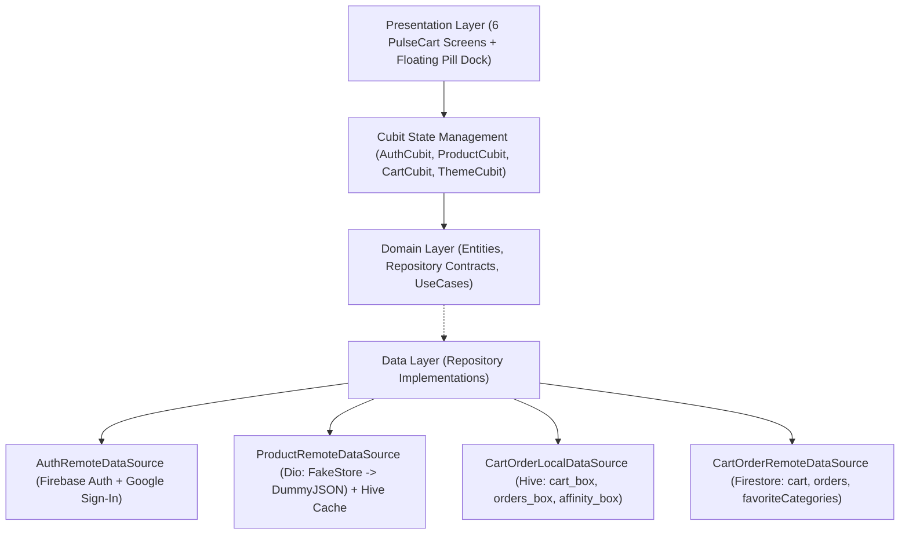

# PulseCart — Flutter E-Commerce Shopping App

> **Task 5 (Advanced) Capstone Project** — Auspify Technologies Practical Learning Internship Program

[](https://flutter.dev)
[](https://dart.dev)
[-4F46E5)](https://bloclibrary.dev)
[](https://firebase.google.com)
[](https://docs.hivedb.dev)
[](#testing--quality)

**PulseCart** is a production-grade, cross-platform Flutter Material 3 E-Commerce application engineered with **Clean Architecture** (`core`, `domain`, `data`, `presentation`) and **Cubit (`flutter_bloc`)**. It delivers an end-to-end mobile shopping experience combining **Firebase Authentication** (Email/Password & One-Tap Google Sign-In), a **3-Tier Resilient REST API Catalog**, a **Hybrid Offline-First Shopping Cart & Order Engine** (Hive NoSQL + Cloud Firestore), **personalized category-affinity recommendations**, a **simulated Checkout & Payment workflow**, and a **Material 3 Light/Dark UI** built directly from the *Vibrant Fluid Commerce* Google Stitch design system.

---

## Key Features

### 1. Authentication & Session Routing (`Firebase Auth` + `Google Sign-In`)
- Email & Password Sign In and Account Registration with live email validation, password visibility toggles, and friendly error translation.
- One-Tap **Google Sign-In** OAuth with automatic Cloud Firestore `users/{uid}` profile creation/sync.
- Reactive `AuthCubit` + centralized `AppRouter` (`pushAndRemoveUntil`) for instant transitions across Login, Register, Home, and Sign Out without stale navigation stacks.

### 2. 3-Tier Resilient Product Catalog (`Dio` + `Hive`)
- **Tier 1 (Primary):** Fetches live catalog & categories from `FakeStoreAPI` (`https://fakestoreapi.com`) via `Dio`.
- **Tier 2 (Live Failover):** Automatically fails over to `DummyJSON` (`https://dummyjson.com`) mapped onto the 4 core retail categories (`electronics`, `jewelery`, `men's clothing`, `women's clothing`) whenever `fakestoreapi.com` drops or rate-limits connections.
- **Tier 3 (Offline Resilience):** Transparently serves cached Hive data (`products_cache_box`) or a curated offline seed catalog if launched completely offline.
- Shimmer skeleton loading states, pull-to-refresh, and `CachedNetworkImage` caching.

### 3. Personalized Recommendations & Similar Products
- Tracks user category interactions (viewing product details, adding to cart, placing orders) both locally in Hive (`affinity_box`) and in Cloud Firestore (`users/{uid}.favoriteCategories` using atomic `FieldValue.increment`).
- Powers the **"Recommended for You"** horizontal carousel on the Home screen and **"Similar Products"** on the Product Details screen.

### 4. Live Search & Advanced Multi-Criteria Filtering
- Instant keyword search across product titles, descriptions, and categories.
- Scrollable category filter pills with live item counters.
- Multi-mode sorting (**Featured**, **Price: Low to High**, **Price: High to Low**, **Top Rated**) and an interactive **Budget Bound `RangeSlider`**.

### 5. Hybrid Offline/Cloud Shopping Cart (`Hive` + `Cloud Firestore`)
- **Zero-latency offline reads & writes** via Hive (`cart_box`), paired with resilient background sync to Cloud Firestore (`users/{uid}/cart/{productId}`).
- Timestamp-aware bidirectional merge on login so items added offline or on another device are never lost.
- Swipe-to-delete (`Dismissible`), quantity steppers (`- / +`), live emerald cart badge counters on the floating glassmorphic bottom dock, and automatic free-shipping progress bar (`Free shipping >= $100`, otherwise `$5.99`).

### 6. Simulated Checkout, Payment Flow & Order History
- Modal `CheckoutBottomSheet` featuring a validated **Shipping Address** form (Full Name, Phone, Street, City) and Payment Method selector (**Cash on Delivery** vs **Simulated Credit/Debit Card UI**).
- Persists immutable order records to both Hive (`orders_box`) and Cloud Firestore (`users/{uid}/orders/{orderId}`), boosts category affinity, clears the active cart, and displays an **Order Confirmation** dialog.
- Dedicated **Profile & Order History** screen with live metrics (`Orders Placed`, `Total Spent`, `In Cart`), expandable order receipts with one-tap **Reorder**, and a Hive-persisted **Light / Dark Mode** toggle.

---

## Architecture Overview



### Project Directory Structure

```text
lib/
├── core/
│   ├── constants/          # API URLs, Hive boxes, Firestore paths, shipping & payment constants
│   ├── di/                 # Zero-dependency compile-time type-safe AppDependencies container
│   ├── errors/             # Failure & Exception hierarchies
│   ├── navigation/         # Centralized AppRouter (pushAndRemoveUntil auth transitions)
│   ├── network/            # Configured DioClient with browser headers & timeout mapping
│   └── theme/              # Vibrant Fluid Commerce tokens (Light & Dark Material 3 themes)
├── domain/
│   ├── entities/           # AppUserEntity, ProductEntity, CartItemEntity, ShippingAddressEntity, OrderEntity
│   ├── repositories/       # AuthRepository, ProductRepository, CartOrderRepository contracts
│   └── usecases/           # Auth, Product, Cart/Order, and Recommendation UseCases
├── data/
│   ├── datasources/        # AuthRemote, ProductRemote/Local, MockCatalogData, CartOrderLocal/Remote
│   ├── models/             # JSON, Hive & Firestore serialization models
│   └── repositories/       # AuthRepositoryImpl, ProductRepositoryImpl, CartOrderRepositoryImpl
├── presentation/
│   ├── cubits/             # AuthCubit, ProductCubit, CartCubit, ThemeCubit
│   ├── pages/
│   │   ├── auth/           # LoginPage & RegisterPage (Screen 1)
│   │   ├── home/           # CatalogHomePage (Screen 2)
│   │   ├── search/         # SearchFilterPage (Screen 3)
│   │   ├── product_details/# ProductDetailsPage (Screen 4)
│   │   ├── cart/           # CartPage & CheckoutBottomSheet (Screen 5)
│   │   ├── profile/        # ProfilePage (Screen 6)
│   │   └── main_shell_page.dart # Floating glassmorphic pill bottom nav dock
│   └── widgets/            # ProductCard, CartItemCard, OrderHistoryCard
├── firebase_options.dart   # Generated via FlutterFire CLI
└── main.dart               # Firebase & Hive init, MultiBlocProvider, boot AuthGate
```

---

## Cloud Firestore Schema & Security Rules

Production-grade owner-isolated rules are included in [`firestore.rules`](firestore.rules) (strict `request.auth.uid == userId` isolation, field allowlists, type/size bounds, immutable orders, and default-deny fallback):

| Path | Fields | Access Policy |
| :--- | :--- | :--- |
| `users/{uid}` | `uid`, `name`, `email`, `photoUrl`, `favoriteCategories`, `createdAt`, `updatedAt` | Owner `read`, `create`, `update`; `delete: false` |
| `users/{uid}/cart/{productId}` | `productId`, `title`, `price`, `image`, `category`, `quantity`, `updatedAt` | Owner `read`, `create`, `update`, `delete` |
| `users/{uid}/orders/{orderId}` | `orderId`, `items`, `subtotal`, `shippingFee`, `totalPrice`, `paymentMethod`, `shippingAddress`, `createdAt`, `status` | Owner `read`, `create`; `update: false`, `delete: false` |

---

## Tech Stack

| Layer | Technology |
| :--- | :--- |
| **Framework & Language** | Flutter (Material 3), Dart 3 |
| **Architecture** | Clean Architecture (`core`, `domain`, `data`, `presentation`) |
| **State Management** | `flutter_bloc` (Cubit), `equatable` |
| **Authentication & Cloud DB** | `firebase_core`, `firebase_auth`, `google_sign_in`, `cloud_firestore` |
| **Local Offline Storage** | `hive`, `hive_flutter` |
| **Networking** | `dio` |
| **UI & Formatting** | `google_fonts` (`Plus Jakarta Sans` & `Inter`), `cached_network_image`, `shimmer`, `intl`, `uuid` |
| **Testing** | `flutter_test`, `bloc_test`, `mocktail` |

---

## Getting Started

### Prerequisites
- Flutter SDK (`3.24+` / Dart `3.x`)
- A Firebase project with **Authentication** (Email/Password + Google) and **Cloud Firestore** enabled
- [FlutterFire CLI](https://firebase.flutter.dev/docs/cli/) installed (`dart pub global activate flutterfire_cli`)

### Installation & Setup

1. **Clone the repository**
   ```bash
   git clone https://github.com/eslam4546/auspify_ecommerce_pulsecart.git
   cd auspify_ecommerce_pulsecart
   ```

2. **Install dependencies**
   ```bash
   flutter pub get
   ```

3. **Configure Firebase (optional if using your own Firebase project)**
   ```bash
   flutterfire configure
   ```
   - In **Firebase Console → Authentication → Sign-in method**, enable **Email/Password** and **Google**.
   - In **Firebase Console → Project Settings → Android App**, register your debug **SHA-1** and **SHA-256** fingerprints and download the updated `google-services.json` into `android/app/`.
   - In **Firebase Console → Firestore Database → Rules**, publish the contents of [`firestore.rules`](firestore.rules).

4. **Run the app**
   ```bash
   flutter run
   ```

---

## Testing & Quality

Run formatting, static analysis, and the Cubit test suite:

```bash
dart format lib test
flutter analyze
flutter test
```

- **`flutter analyze`:** 0 errors, 0 warnings, 0 lint infos.
- **`flutter test`:** **13/13 tests passing** covering `AuthCubit` (`test/presentation/cubits/auth_cubit_test.dart`), `ProductCubit` (`test/presentation/cubits/product_cubit_test.dart`), and `CartCubit` (`test/presentation/cubits/cart_cubit_test.dart`).

---

## Author

Built by **Eslam Hany** as part of the **Auspify Technologies Internship Program** (Task 5 — Advanced Capstone).
